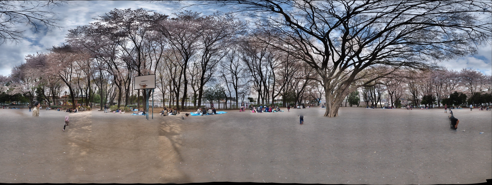

# Japanese Cherry Blossom Party 2

GigaPan.com で公開されていたギガピクセルパノラマ（GigaPan ID: 74675）のアーカイブです。公開 API・ページ・KML・タイル画像を [GigaPan Salvager](https://github.com/mapconcierge/GigaPanSalvager) で取得・検証し、`docs/` を GitHub Pages として公開できる形で保存しています。



- 元ページ: <https://gigapan.com/gigapans/74675>
- ビューア: <https://mapconcierge.github.io/gigapan_74675/>（このリポジトリ内: [`docs/index.html`](docs/index.html)）
- Google Earth 用 KML: <https://mapconcierge.github.io/gigapan_74675/gigapan_74675.kml>

## パノラマの概要

| 項目 | 内容 |
| --- | --- |
| タイトル | Japanese Cherry Blossom Party 2 |
| 撮影日時 | 2011-04-10 09:21 (UTC-0400) |
| GigaPan 登録日時 | 2011-04-10 12:54 (UTC-0400) |
| 最終更新 | 2013-08-14 07:30 (UTC-0400) |
| 公開状態 | 公開（`is_private: false`） |
| 閲覧数 | 237 回（取得時点） |
| Explore score | 1.0 |

## 画像の仕様

| 項目 | 内容 |
| --- | --- |
| サイズ | 39,288 × 14,784 px（約 581 メガピクセル） |
| 画角 | 水平 360°、垂直 135.467°（上 +75.7° / 下 -59.8°） |
| タイル | 256 px 角 JPEG、9 レベル、総数 11,966 枚 |
| 形状 | 全周（球面）パノラマ |

## 撮影位置

座標系は WGS84（EPSG:4326）です。

| 項目 | 内容 |
| --- | --- |
| 緯度・経度 | 35.798088, 139.434496 |
| 高度 | 6 m |
| 向き（heading） | 0° |
| 傾き（tilt） | 90° |
| 地図 | [OpenStreetMap](https://www.openstreetmap.org/?mlat=35.798088&mlon=139.434496#map=16/35.798088/139.434496) |

## 撮影・合成情報

GigaPan Stitch が記録した合成時の情報（`stitcher_notes` 原文）です。

```text
GigaPan Stitch version 1.0.0805 (Windows)
Panorama size: 580 megapixels (39288 x 14784 pixels)
Input images: 242 (22 columns by 11 rows)
Field of view:  360.0 degrees wide by 135.5 degrees high (top=75.7, bottom=-59.8)
Settings:
  All default settings
Original image properties:
  Camera make: OLYMPUS IMAGING CORP.  
  Camera model: E-P1            
  Image size: 2560x1920 (4.9 megapixels)
  Capture time: 2011-04-10 13:12:07 - 2011-04-10 13:29:51
  Aperture: f/5.6 - f/11
  Exposure time: 0.0005 - 0.008
  ISO: 200 - 320
  Focal length (35mm equiv.): unknown
  Digital zoom: off
  White balance: Automatic, Fixed
  Exposure mode: Automatic
Horizontal overlap: 22.3 to 81.7 percent
Vertical overlap: 28.8 to 41.2 percent
Computer stats: 3061.98 MB RAM, 4 CPUs
Total time 16:12 (4.0 seconds per picture)
  Alignment: 5:26, Projection: 1:55, Blending: 8:50
(Preview finished in 9:27)
```

## 関連パノラマ

GigaPan ページに表示されていた関連作品（[`page_config.json`](docs/metadata/page_config.json) に 20 件）です。

- [岩手県:大槌町:東京大学 国際沿岸海洋研究センター:サウンドスケープOTOHAMA録音場所(7/23)（82707）](https://gigapan.com/gigapans/82707)
- [Rock In Japan 2011（83597）](https://gigapan.com/gigapans/83597)
- [Garden of God in Colorado（86979）](https://gigapan.com/gigapans/86979)
- [Hack for Japan at Tohno Magokoro NET（82444）](https://gigapan.com/gigapans/82444)
- [Ohtsuchi Town hall（78049）](https://gigapan.com/gigapans/78049)
- [Inside of Volunteer House in Kazawa（25876）](https://gigapan.com/gigapans/25876)
- [NishiAwakura（92211）](https://gigapan.com/gigapans/92211)
- [Near by Ohtsuchi station in Ohtsuchi（78401）](https://gigapan.com/gigapans/78401)
- [Natural Environmental Design Studio in Chichibu（89981）](https://gigapan.com/gigapans/89981)
- [Natural Environmental Design Studio in Chichibu（89999）](https://gigapan.com/gigapans/89999)
- [Asa Sul（94606）](https://gigapan.com/gigapans/94606)
- [Ando area in Ohtsuchi（78237）](https://gigapan.com/gigapans/78237)
- [IBAMA's garden in Brasilia（94406）](https://gigapan.com/gigapans/94406)
- [Kirikiri area in Ohtsuchi（78288）](https://gigapan.com/gigapans/78288)
- [GeoGeo Stamp rally 2009 a（28615）](https://gigapan.com/gigapans/28615)
- [Morino-Kurashino-Sato in Ohmachi, Nagano（89877）](https://gigapan.com/gigapans/89877)
- [The little wetland（25947）](https://gigapan.com/gigapans/25947)
- [OpenConcierge Office（23245）](https://gigapan.com/gigapans/23245)
- [GeoGeo Stamp Rally 2009 b（28617）](https://gigapan.com/gigapans/28617)
- [岡山県:西粟倉村:森の学校裏手の田んぼ(11/16)（92187）](https://gigapan.com/gigapans/92187)

## アーカイブの取得結果

2026-10-23 に取得・検証した結果です（[`job-result.json`](job-result.json)、[`docs/audit.json`](docs/audit.json)）。

| 項目 | 内容 |
| --- | --- |
| ステータス | complete — 全タイル検証済み（終了コード 0） |
| タイル | 期待 11,966 枚 / 検証済み 11,966 枚 / 欠落 0 枚 |
| タイル容量 | 約 261.0 MB（261,011,049 bytes） |
| 所要時間 | 約 7 分 27 秒 |
| 取得ツール | GigaPan Salvager v0.9.0 |

## GitHub Pages で公開する

`docs/` がそのまま公開サイトです。KML のタイル参照は公開 URL <https://mapconcierge.github.io/gigapan_74675/> を前提にした絶対パスです。

1. GitHub に `gigapan_74675` という名前のリポジトリを作り、このフォルダを push します。
2. Settings → Pages → Build and deployment で **Deploy from a branch**、ブランチ `main`、フォルダ **`/docs`** を選びます。
3. 数分後に <https://mapconcierge.github.io/gigapan_74675/> でビューア、<https://mapconcierge.github.io/gigapan_74675/gigapan_74675.kml> で Google Earth 用 KML が開けます。

`tiles/` と `ge_tiles/` は同じ画像です（Git では同一内容として1回だけ保存されます）。GitHub Pages の公開サイトは 1 GB までです。

## ディレクトリ構成

| パス | 内容 |
| --- | --- |
| [`docs/`](docs/) | 公開用ファイル一式（GitHub Pages の公開フォルダ） |
| `docs/index.html` / `docs/viewer.html` | 外部ライブラリ不要のブラウザ用ビューア（同じ内容） |
| `docs/preview.jpg` | 完全に取得できた低解像度層のプレビュー |
| `docs/tiles/` | 配信元の四分木構造のままのタイル JPEG |
| `docs/ge_tiles/` | Google Earth 用の `level/y/x.jpg` 構造（`tiles/` と同じ画像） |
| `docs/gigapan_74675.kml` | Google Earth 用 KML（タイル参照は公開 URL の絶対パス） |
| `docs/gigapan_74675_local.kml` | 同じ KML のローカル版（`ge_tiles/` を相対参照。展開したフォルダで使用） |
| `docs/thumbnails/` | パノラマ・スナップショットの公開サムネイル（取得できた場合） |
| `docs/tile_manifest.csv` | 全タイルの座標・取得 URL・バイト数・SHA-256・検証結果 |
| `docs/audit.json` / `docs/missing_tiles.json` / `docs/plan.json` | 検証結果・欠落タイル・画像寸法 |
| `docs/metadata/` | 取得した元メタデータ（下表） |
| `job-result.json` | 取得ジョブの結果 |

### `docs/metadata/` の内容

| ファイル | 内容 | 取得元 |
| --- | --- | --- |
| [`gigapan.json`](docs/metadata/gigapan.json) | パノラマ本体の情報（原本） | `gigapan.com/gigapans/74675.json` |
| [`normalized.json`](docs/metadata/normalized.json) | 上記の正規化版（文字化けの置換・寸法の補完） | 加工 |
| [`page.html`](docs/metadata/page.html) | GigaPan ページの HTML（書き換えなし） | `gigapan.com/gigapans/74675` |
| [`page_config.json`](docs/metadata/page_config.json) | ビューア設定（寸法・タイル配信元・関連パノラマ） | `page.html` から抽出 |
| [`retrieval_log.json`](docs/metadata/retrieval_log.json) | 取得日時・URL・ETag・エラーの記録 | — |
| [`snapshots_normalized.json`](docs/metadata/snapshots_normalized.json) | スナップショット一覧の正規化版 | 加工 |
| [`snapshots_page_1.json`](docs/metadata/snapshots_page_1.json) | スナップショット一覧（原本） | `.../snapshots.json?page=N&per_page=100` |
| [`source.kml`](docs/metadata/source.kml) | Google Earth 用 PhotoOverlay の原本 | `gigapan.com/gigapans/74675.kml` または `--kml` |

## 権利・出典

- 元データ: [GigaPan 74675](https://gigapan.com/gigapans/74675)
- 写真・説明・コメントの権利は各著作者に帰属します。利用条件は上記の説明文・元ページの表記に従ってください（このアーカイブで元の著作物に独自のライセンスを付与するものではありません）。
- このリポジトリの構成・ビューア・KML・メタデータ整理などアーカイブ作業部分は [CC0 1.0（パブリック・ドメイン）](LICENSE) で提供します。
- 元の撮影素材・非公開画像・アカウント限定の内容は含みません。`metadata/page.html` は原本のまま保存しているため外部サイトを参照します。

---

Generated by [GigaPan Salvager](https://github.com/mapconcierge/GigaPanSalvager) v0.9.0.
